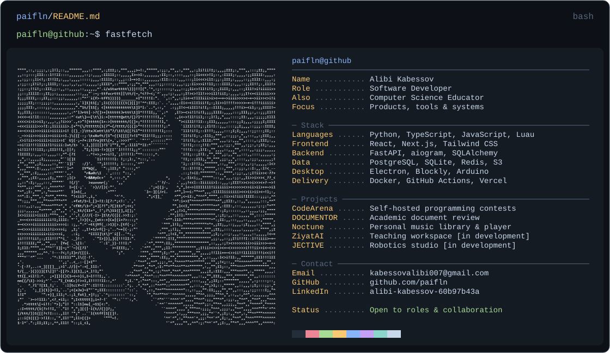

  

  <a href="mailto:kabessovalibi007@gmail.com">Email</a> &nbsp; / &nbsp;
  <a href="https://www.linkedin.com/in/alibi-kabessov-60b97b43a/">LinkedIn</a> &nbsp; / &nbsp;
  <a href="https://github.com/paifln?tab=repositories">Repositories</a>

<!-- Terminal source: assets/ascii-art.txt + scripts/render_fastfetch.py.
     Regenerate with: python scripts/render_fastfetch.py -->
